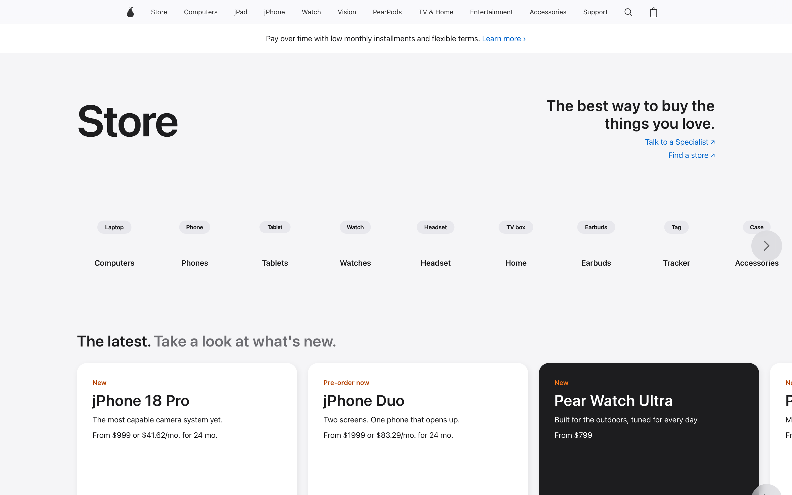
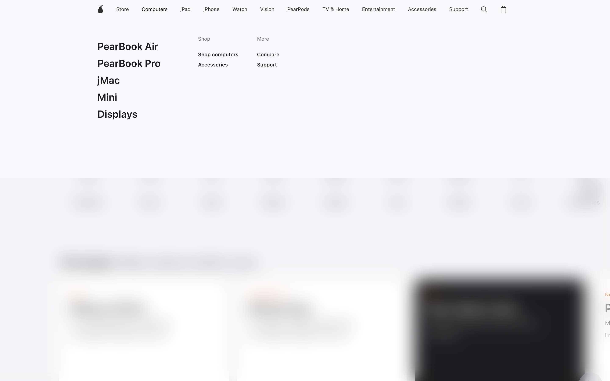
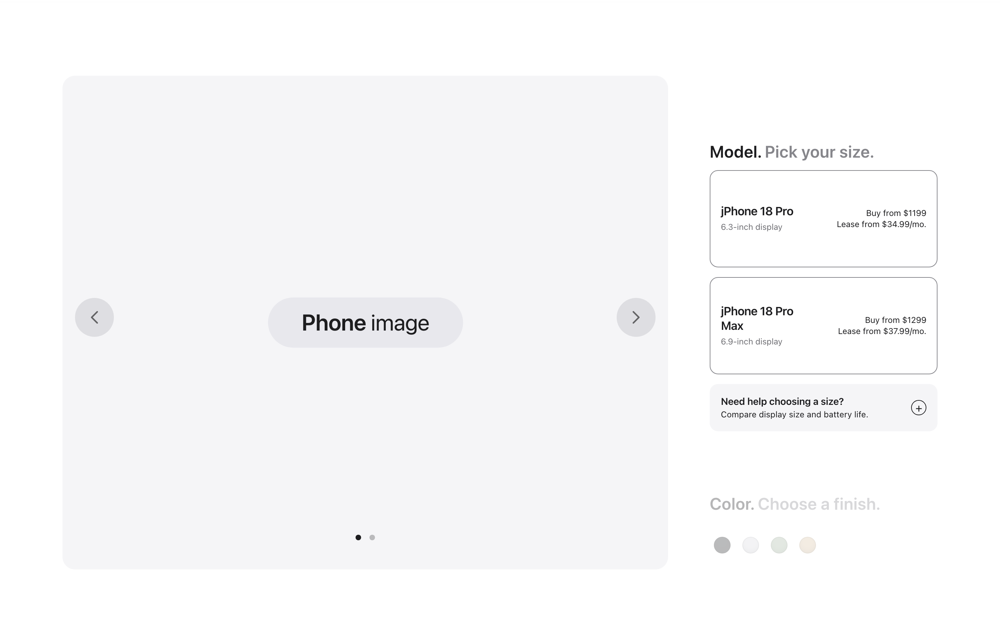
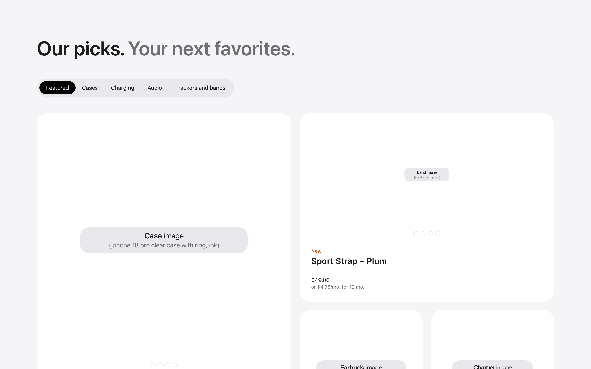
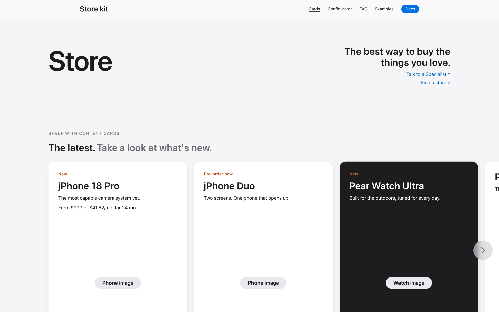
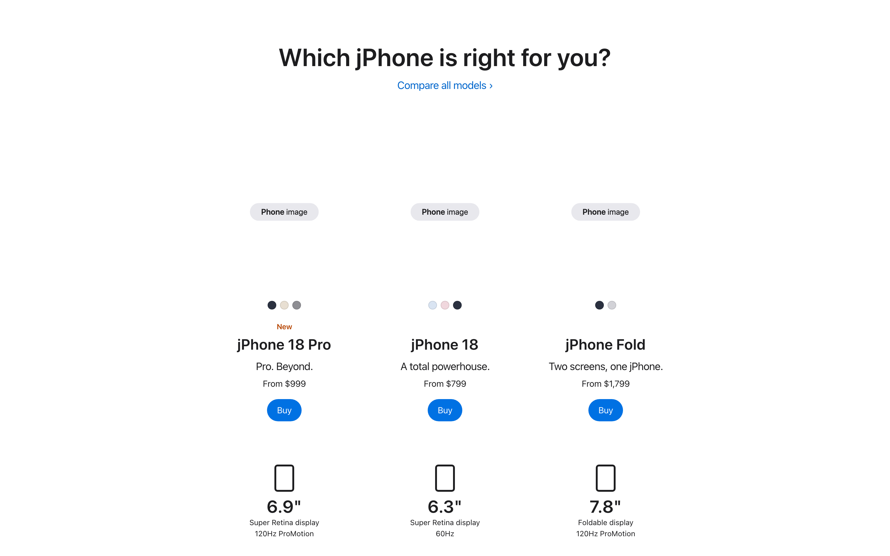
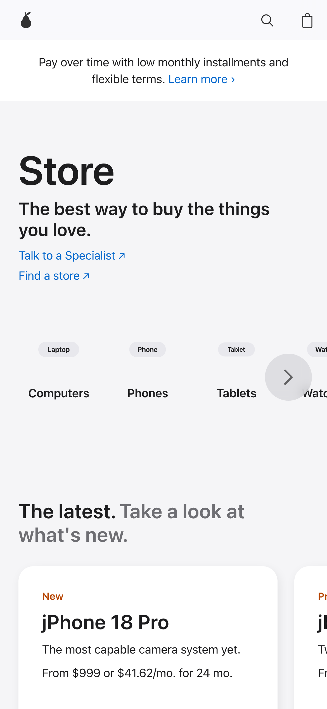

# Apple Store clone (2026)

[](https://github.com/eliorpom-cmd/apple-store-clone/actions/workflows/site.yml)

**Live demo: [eliorpom-cmd.github.io/apple-store-clone](https://eliorpom-cmd.github.io/apple-store-clone/)** (demo mode,
fictional content) · [component kit](https://eliorpom-cmd.github.io/apple-store-clone/kit/)

A 1:1 rebuild of Apple's online store (`apple.com/store`, the `/shop/...` pages, `/retail`, `/today`), reverse
engineered in October 2026 and written as clean, maintainable code. Plain HTML, CSS and JavaScript, no build step.

**Reverse engineered, not copied.** No HTML, CSS or JavaScript was taken from the source. Every size, spacing,
timing and colour was measured on the rendered pages, then rebuilt from scratch:

- one set of design tokens (`tokens.css`, documented in `DESIGN.md`), no `!important`, no hard-coded colour
  without a comment saying where it comes from;
- shared components (nav, shelves, cards, configurator steps, gallery, summary, local bar) reused across 29 page
  templates, behaviours wired by `data-*` attributes;
- a visual diff against the live source for every page: 62 pages, all at 97/100 or above, mean 98.2.

The repository ships **only the shell**: layout, components, page templates and placeholder content
("Pear Store", fictional products such as jPhone, jPad, PearBook and Pear Watch, labelled image placeholders). No Apple text, image or font is included.

> This is an independent study project. It is not affiliated with, endorsed by, or connected to Apple Inc.
> Apple, iPhone, iPad, Mac and the other product names mentioned in code comments and tools are trademarks of
> Apple Inc.

## Screenshots

Demo mode (fictional "Pear Store" content, as shipped in this repository):

| Store home | Global nav menu |
|---|---|
|  |  |
| **Configurator** | **Accessories** |
|  |  |

Reusable kit and mobile layout:

| Kit components | Model comparator | Mobile (390 px) |
|---|---|---|
|  |  |  |

## Reusable kit

`kit/` holds the reusable version: the same tokens and components with no hard-coded values, fluid type,
container queries and cascade layers, documented in [`kit/README.md`](kit/README.md) and shown in `kit/index.html`.
Start there to build your own store pages; the clone pages keep the measured values of the original.

## Run it

```sh
npm install
npx playwright install chromium   # only needed for the live mode and the tools
npm run serve                      # http://localhost:4321
```

Any static file server works for the demo mode: open `index.html`, or a page in `pages/`.

## Two modes

**Demo mode** (default) shows the templates filled with fictional content. This is what the repository is for:
29 pages covering the store home, category shelves, product pages, configurators (computer, phone, watch),
accessories, gift cards, trade-in, refurbished listings, help, bag, stores and sessions. `pages/components.html`
lists every shared component.

**Live mode** is a local research tool. `npm run serve`, then open `http://localhost:4321/?content=live`. The local
server opens the matching source page in a headless browser, extracts its content (text, image URLs, structure)
into `content/live/` (git-ignored), and the local template renders it. This is how the templates were compared
with the source. Nothing extracted is ever committed.

Keep the live mode on your own machine. Do not deploy it: a public copy would imitate the source site and
republish its content. The pages only switch to live mode on `localhost`; on any other host they stay in demo
mode.

## How the code is organised

| Path | Role |
|---|---|
| `assets/css/tokens.css` | design tokens (colours, type scale, spacing, radii, motion), copied from `DESIGN.md` |
| `assets/css/base.css` | reset, fonts, page defaults |
| `assets/css/components/shell.css` | global nav, flyout menus, search, bag, mobile menu, banner, footer |
| `assets/css/components/components.css` | shared components: buttons, shelves, cards, modal, accordion, tabs, options, swatches, gallery, summary, local bar |
| `assets/css/pages/*.css` | one file per family of templates |
| `assets/js/shell.js` | injects the nav, banner and footer into `<div data-shell="…">` |
| `assets/js/components.js` | behaviours wired by `data-*` attributes (list at the top of the file) |
| `assets/js/content.js`, `assets/js/live/` | live mode: loads the extracted JSON and renders it per template |
| `tools/` | live server, extractors, measurement and check tools |
| `DESIGN.md` | the design reference: principles, tokens, components, values outside tokens |
| `docs/MAINTENANCE.md` | how to refresh the live cache and re-measure after the source changes |

## Tools

| Command | What it does |
|---|---|
| `npm run serve` | live and static server on port 4321 |
| `npm run check` / `npm run check:live` | JS errors, overflow at 1440 and 390 px, dead links, on every page |
| `npm run scores` | visual diff of every live page against its source, section by section |
| `node tools/visual-diff.mjs <local> <source> <out>` | diff of one page, with the worst sections side by side |
| `node tools/compare.mjs <local> <source> <out> [--width 390]` | diff of computed styles |
| `npm run refresh` | re-extract the cached source pages |

The last full run of `npm run scores` gave 62 pages, all at 97/100 or above, mean 98.2. A perfect score is not
reachable: the source content changes, videos play, and fonts are not shipped.

## Fonts

The demo mode uses the system font stack (`-apple-system`, then Inter from Google Fonts, Helvetica Neue, Arial).
On macOS and iOS this renders the system font without redistributing any font file. The live mode uses
SF Pro Text and SF Pro Display when they are installed on your machine, so lines wrap where the source wraps.

## Licence

MIT, see `LICENSE`. The licence covers the code and the placeholder content in this repository, not the content of
the source site loaded by the live mode.
